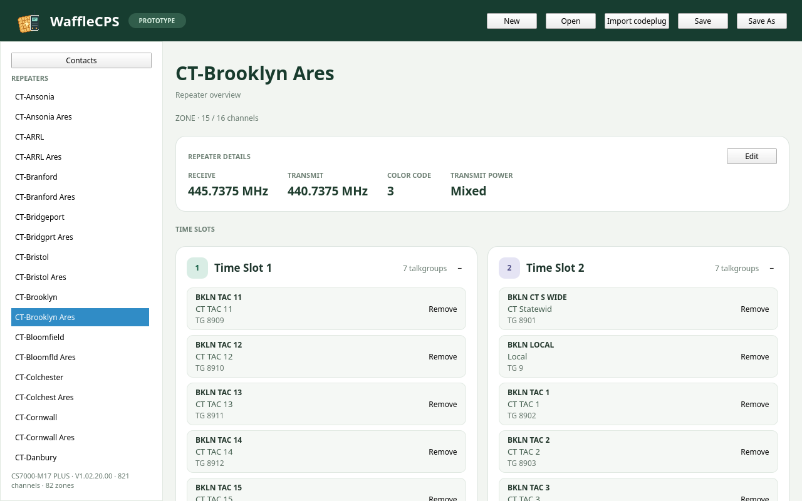
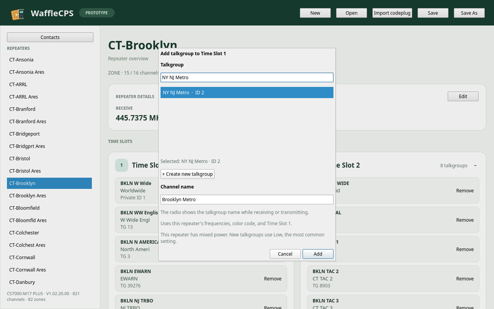
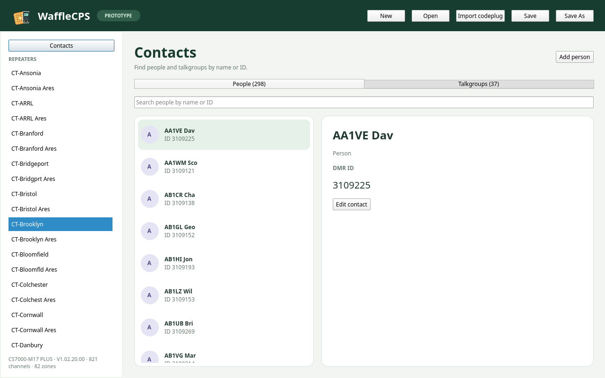

# WaffleCPS

WaffleCPS is an early desktop editor for DMR codeplugs. It organizes programming around repeaters, time slots, and talkgroups so you can see how you will use a radio without working through a traditional channel table.

The application is under active development. It can import tested Connect Systems CS7000 codeplug layouts, save work in an open `.waffle` project, and export a prototype CS7000 `.rdbx` file. Keep your original codeplug. Exported files still need validation in the radio's CPS before use; WaffleCPS cannot write to a radio yet.

## Screenshots

These views use an imported CS7000 GPS codeplug.

**Repeater overview** — CT-Brooklyn Ares, with separate time-slot cards and talkgroup details.



**Add talkgroup** — choose an existing group contact and give the radio channel its own name.



**Contacts** — people and talkgroups have separate searchable tabs.



## What works today

- Import `.rdbx` files with the **CS7000-M17 Plus / CS7000 GPS firmware layout from CPS V1.02.20.00 or V1.02.21.00**. The populated sample came from a CS7000 GPS radio running the same firmware as the Plus; the newer CPS sample is a default codeplug. Other models and CPS versions have not been verified.
- Browse imported repeaters, zones, channels, and contacts. A zone with one repeater frequency pair and color code appears as a repeater, even if it also contains simplex frequencies. Separate zones remain separate entries.
- View each repeater's frequencies, color code, transmit power, time slots, and additional simplex frequencies. The channel name appears above its talkgroup name and ID, matching the radio's idle versus receive/transmit display behavior.
- Search people and talkgroups in separate contact tabs. Add a repeater talkgroup from the group contact list or create one in the same flow, with a separate name for its radio channel.
- Add or remove talkgroups and additional simplex frequencies. When an imported channel is shared with another zone, removing it from the selected zone leaves the shared record available to the other zone.
- Create a blank project and save or open `.waffle` projects. Imported projects retain the original codeplug bytes as an untouched attachment.
- Set a radio name or call sign and DMR radio ID on the Radio Settings page. Imported values are shown automatically and saved with the project.
- Export a prototype CS7000 `.rdbx` file with radio identity, contacts, channels, and zones. New projects use an embedded copy of the supplied CS7000 default codeplug; imported projects use their preserved source.

The editor does not yet decode every radio setting, receive group, or scan list. Export is experimental and has not been verified for writing to a radio. The [project checklist](docs/ProjectChecklist.md) tracks the remaining work.

## Build and run

WaffleCPS uses C++17, CMake 3.21 or newer, Qt 6.4 or newer, and zlib. On Ubuntu 24.04, install the build tools and Qt development/QML packages:

```sh
sudo apt install cmake g++ zlib1g-dev qt6-base-dev qt6-declarative-dev \
  qml6-module-qtqml qml6-module-qtqml-workerscript \
  qml6-module-qtquick qml6-module-qtquick-controls \
  qml6-module-qtquick-layouts qml6-module-qtquick-templates \
  qml6-module-qtquick-window
```

Then build and launch the application:

```sh
cmake -S . -B build
cmake --build build
./build/wafflecps
```

Use **Import codeplug** for a supported `.rdbx` file, or **Open** for a `.waffle` project. You can also pass either file type when launching the app:

```sh
./build/wafflecps path/to/project.waffle
./build/wafflecps path/to/codeplug.rdbx
```

Run the automated checks with:

```sh
ctest --test-dir build --output-on-failure
```

WaffleCPS uses Qt and CMake, but Windows and macOS builds have not yet been verified or packaged. The app icon is generated from `tools/render_icon.py`; Pillow is needed only to regenerate the image, not to build WaffleCPS.

## Project documents

- [Project checklist](docs/ProjectChecklist.md) — agreed scope and progress.
- [Project plan](ProjectPlan.md) — original product direction.
- [Project format](docs/ProjectFormat.md) — the open `.waffle` archive format.
- [Import and data model](docs/ImportAndDataModel.md) — classification and editor design.
- [Codeplug research](docs/CodeplugResearch.md) — findings from the tested sample.

## License and support

WaffleCPS is licensed under the [GNU General Public License version 3](LICENSE).

If you would like to support development, you can [buy the author a coffee](https://buymeacoffee.com/compuvin).

[](https://www.codefactor.io/repository/github/compuvin/wafflecps)
