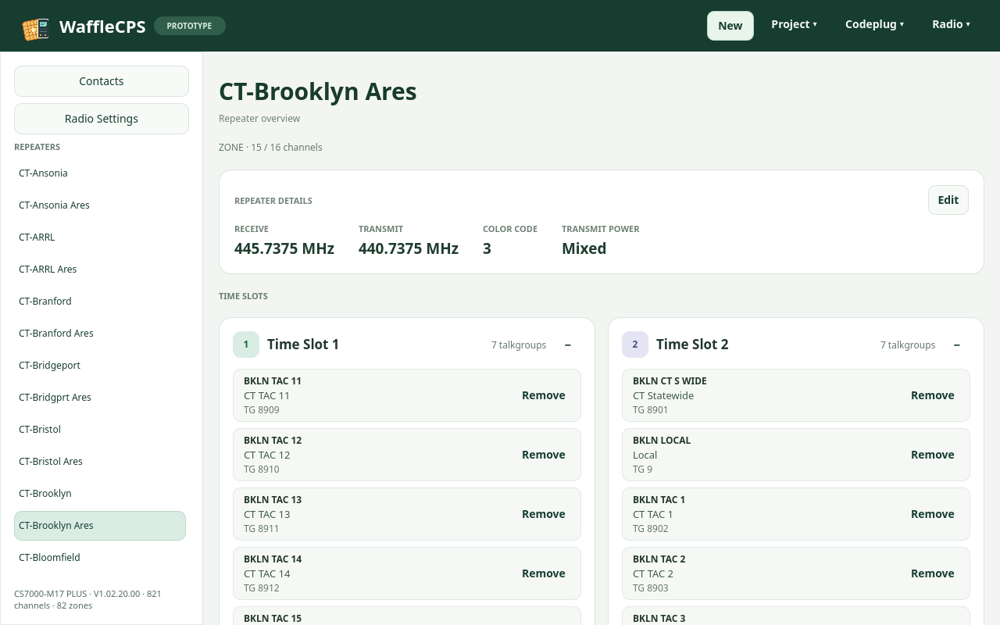
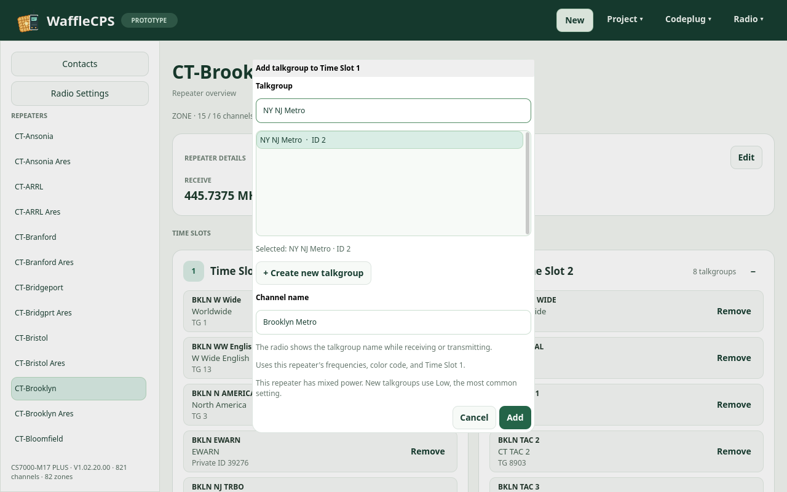
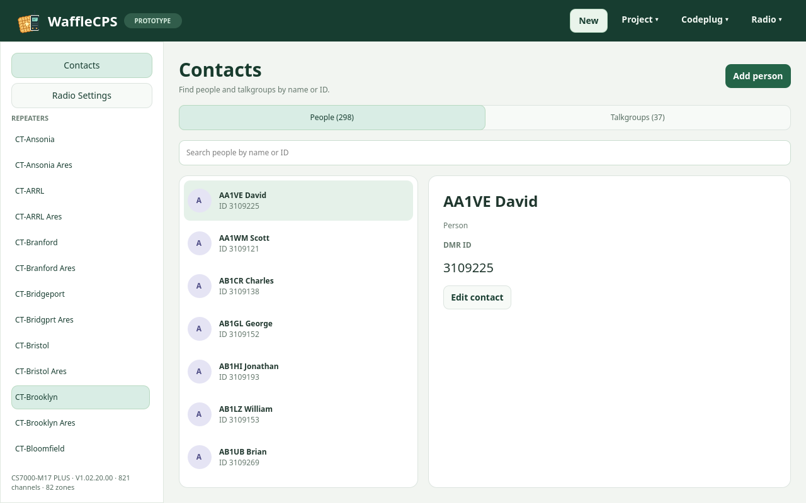

# WaffleCPS

**What WaffleCPS is:** A simple way to program DMR radios without the complexity of traditional CPS software.

**What WaffleCPS isn't:** A tool for configuring every advanced or manufacturer-specific radio setting.

WaffleCPS organizes DMR radio programming around repeaters, time slots, and talkgroups. A **codeplug** is the file containing your radio's programming. When importing an existing codeplug, WaffleCPS aims to preserve settings it doesn't manage.

The application is under active development and works offline, without accounts or subscriptions.

## Download

Get the latest version from [GitHub Releases](https://github.com/compuvin/WaffleCPS/releases/latest). Choose the package for your computer:

| Platform | Download |
| --- | --- |
| Windows x64 | `.exe` installer |
| Ubuntu 24.04 amd64 | `amd64.deb` package |
| Ubuntu 24.04 arm64 | `arm64.deb` package |
| macOS on Apple silicon | `macos-arm64.dmg` |

The packages include the radio definitions. Building from source is optional; instructions are below.

## Getting started

1. Click **New**, search for your radio, and select it.
2. Enter your call sign and DMR ID now, or add them later in **Radio Settings**. The **Get a DMR ID** link takes you to Radio ID registration.
3. Click **Add repeater**, enter its frequencies and color code, then add talkgroups to its time slots.
4. Use **Project → Save** to keep your work as a `.waffle` project.
5. Use **Codeplug → Export** to create a programming file for your selected radio, or **Radio → Write** when radio transfer is supported.

You can also begin with **Codeplug → Import** to open an existing codeplug, **Project → Open** to resume a saved project, or **Radio → Read** to download a supported radio's current programming. At startup, Read asks you to choose a radio; an existing radio project supplies that selection.

**Save** keeps an editable WaffleCPS project, including the original codeplug when one was imported or read. **Export** creates the radio's native codeplug file. The **Blank project** option lets you work without selecting a radio and save a project; converting it to a radio-specific codeplug is a future feature.

## Radio support

Included codeplug definitions cover these radios and file formats. Compatibility depends on the particular model, version, and file layout.

| Radio or firmware | Codeplug file | Radio transfer definition included |
| --- | --- | --- |
| CS7000-M17 Plus | `.rdbx` | Yes |
| CS700 / CS701 | `.rdt` | Yes |
| CS750 | `.rdb` (D4.0.03 and D4.3.01 layouts) | No |
| CS800 | `.rdb` | No |
| MD-380 | `.rdt` | Yes |
| OpenGD77 | `.g77` | Yes |
| DM-32UV | `.data` | Yes |

Radio read and write have been tested on hardware with the CS7000-M17 Plus, CS700/CS701, and a DM-1701 running OpenGD77. The presence of a transfer definition for MD-380 or DM-32UV does not establish successful hardware testing. Other OpenGD77 radio types also need their own verification.

Keep your original codeplug and a backup of your radio's programming. Backups are manual; see [Radio operations](docs/RadioOperations.md).

## Screenshots

These views use an imported CS7000 GPS codeplug.

**Repeater overview** — CT-Brooklyn Ares, with separate time-slot cards and talkgroup details.



**Add talkgroup** — choose an existing group contact and give the radio channel its own name.



**Contacts** — people and talkgroups have separate searchable tabs.



## What works today

- Import codeplug files with automatic format detection or choose a radio definition explicitly.
- Browse imported repeaters, zones, channels, and contacts. A zone with one repeater frequency pair and color code appears as a repeater, even if it also contains simplex frequencies. Separate zones remain separate entries.
- View each repeater's frequencies, color code, transmit power, time slots, and additional simplex frequencies. The channel name appears above its talkgroup name and ID.
- Search people and talkgroups in separate contact tabs. Add a repeater talkgroup from the group contact list or create one in the same flow, with a separate name for its radio channel.
- Add or remove talkgroups and additional simplex frequencies. When an imported channel is shared with another zone, removing it from the selected zone leaves the shared record available to the other zone.
- Create a blank project and save or open `.waffle` projects. Imported projects retain the original codeplug bytes as an untouched attachment.
- Set a radio name or call sign and DMR radio ID on the Radio Settings page. Imported values are shown automatically and saved with the project.
- Create a new codeplug for a selected radio, or export an edited import using its radio definition and preserved source bytes.
- Read and write radios using the included transfer definitions, as described in Radio support above.

The editor does not yet expose every radio setting, receive group, or scan list. File export remains experimental; keep your original codeplug and check exports in the vendor's CPS. The [project checklist](docs/ProjectChecklist.md) tracks the remaining work.

## Build from source

WaffleCPS uses C++17, CMake 3.21 or newer, Qt 6.4 or newer with Qt SerialPort, zlib, and libusb. On Ubuntu 24.04, install the build tools and Qt development/QML packages:

```sh
sudo apt install cmake g++ pkg-config libusb-1.0-0-dev zlib1g-dev qt6-base-dev qt6-declarative-dev qt6-serialport-dev \
  qml6-module-qtqml qml6-module-qtqml-workerscript \
  qml6-module-qtquick qml6-module-qtquick-controls \
  qml6-module-qtquick-layouts qml6-module-qtquick-templates \
  qml6-module-qtquick-window
```

Then build and launch the application:

```sh
cmake -S . -B build
cmake --build build
./build/wafflecps
```

Keep the `definitions/` directory available beside the project or executable. Use **Import codeplug** for a file format declared by a loaded definition, or **Open** for a `.waffle` project. You can also pass either file type when launching the app:

```sh
./build/wafflecps path/to/project.waffle
./build/wafflecps path/to/codeplug.rdbx
```

File handling uses external `.wcp` definitions; radio transfers use companion `.wrd` definitions. See [radio reading](docs/RadioReading.md) for the CS7000 read workflow and Linux USB permission instructions.

Run the automated checks with:

```sh
ctest --test-dir build --output-on-failure -E '^RequiresCodeplug-'
```

Run without `-E` when the required local samples are present in `Codeplugs/`.

## Project documents

- [Project checklist](docs/ProjectChecklist.md) — agreed scope and progress.
- [Project plan](ProjectPlan.md) — original product direction.
- [Project format](docs/ProjectFormat.md) — the open `.waffle` archive format.
- [Import and data model](docs/ImportAndDataModel.md) — classification and editor design.
- [Codeplug research](docs/CodeplugResearch.md) — findings from the tested sample.

## License and support

WaffleCPS is licensed under the [GNU General Public License version 3](LICENSE).

If you would like to support development, you can [buy the author a coffee](https://buymeacoffee.com/compuvin).

[](https://www.codefactor.io/repository/github/compuvin/wafflecps)
