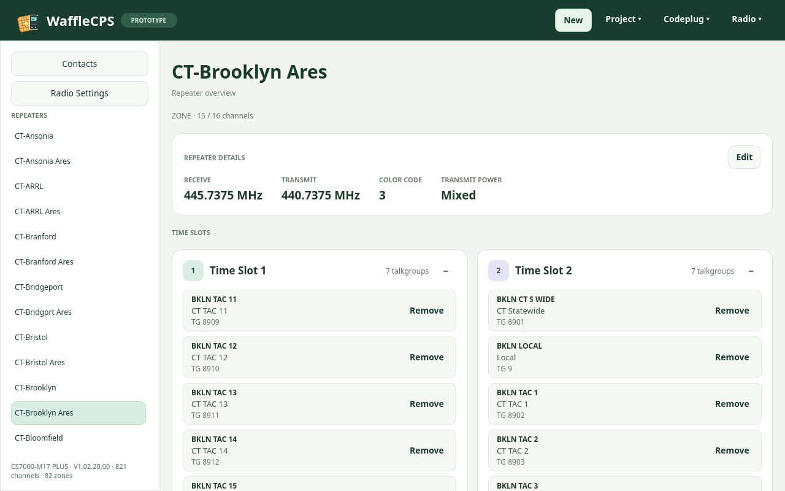
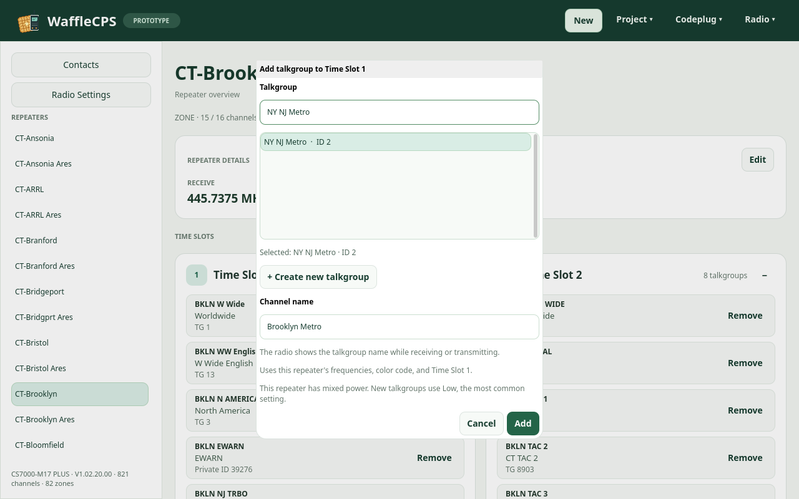
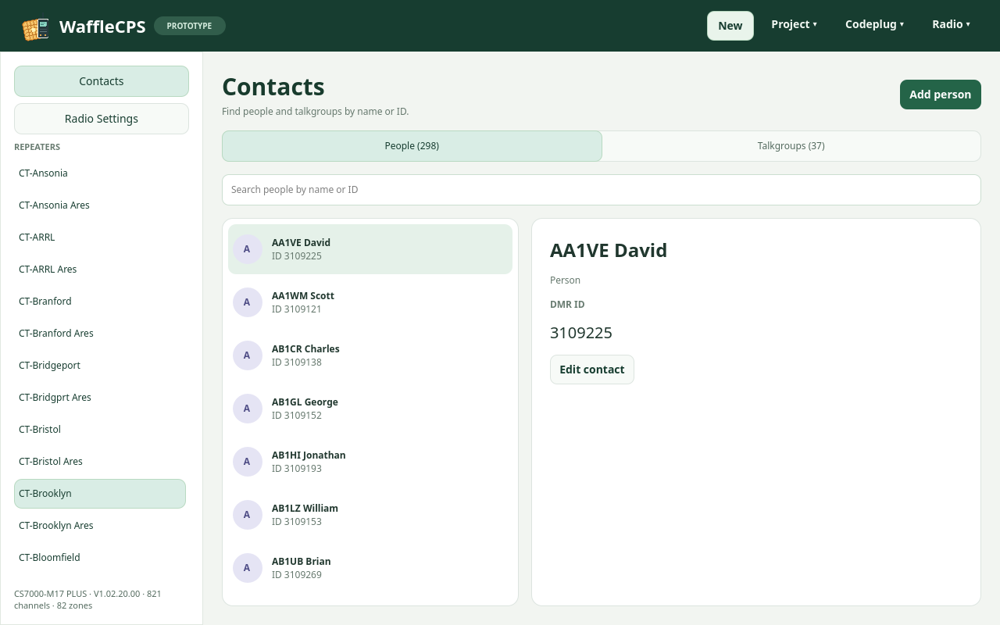

# WaffleCPS

**What WaffleCPS is:** A simple way to program DMR radios without the complexity of traditional CPS software.

**What WaffleCPS isn't:** A tool for configuring every advanced or manufacturer-specific radio setting.

Build your programming around repeaters and the talkgroups you want to use. You can start fresh, edit an existing codeplug, or read programming from a supported radio. A **codeplug** is the file containing your radio's programming.

WaffleCPS is under active development. It works offline without accounts or subscriptions. Updating satellite orbital data requires an internet connection.

## Download

Download the latest version from [GitHub Releases](https://github.com/compuvin/WaffleCPS/releases/latest). Radio definitions are included; you do not need to build the application yourself.

| Your computer | Choose |
| --- | --- |
| Windows x64 | `.exe` installer |
| Ubuntu 24.04 amd64 | `amd64.deb` package |
| Ubuntu 24.04 arm64 | `arm64.deb` package |
| macOS with Apple silicon | `macos-arm64.dmg` |

## Start programming

Choose the starting point that fits your situation:

- **Starting fresh:** click **New** and choose your radio.
- **Using an existing codeplug:** choose **Codeplug → Import**.
- **Using programming already on your radio:** connect and power on the radio, then choose **Radio → Read**.
- **Continuing saved work:** choose **Project → Open** and select your `.waffle` project.

For a new project, enter your call sign and DMR ID now or add them later in **Radio Settings**. The **Get a DMR ID** link opens registration.

Click **Add repeater**, enter its receive frequency, select its offset or enter its transmit frequency, and set its color code. Use the repeater's published settings. Then add talkgroups to the appropriate time slots. The **?** buttons explain unfamiliar settings.

The left sidebar lets you switch between repeaters and zones. A **zone** is a group of channels selected together on the radio; use one to combine channels for a trip, an event, or local use. People and talkgroups are managed under **Contacts**.

## Save your work or program the radio

| What you want to do | Use |
| --- | --- |
| Keep working on the project later | **Project → Save** — creates a `.waffle` project |
| Open your programming in the manufacturer's software | **Codeplug → Export** — creates the selected radio's codeplug file |
| Send your programming directly to a supported radio | **Radio → Write** |

When a project began with an imported file or a radio read, its saved `.waffle` project retains the original codeplug bytes. Waffle aims to preserve settings it does not manage when editing that codeplug.

A **Blank project** lets you work without choosing a radio. Use **Codeplug → Convert** to select a destination radio before exporting or writing.

Keep a backup before writing to your radio. Waffle does not automatically read or back up the radio before a write. See [Radio operations and backups](docs/RadioOperations.md) for the steps and platform-specific access information.

## Common tasks

**Reuse a repeater setup.** Choose **Duplicate** in Repeater Details. Copy just its details or its full channel lineup, then edit the new repeater. The full copy initially uses the same channels and talkgroups.

**Edit a channel used in several places.** In the zone editor, Waffle lists its other uses and asks whether to apply the change only here or everywhere. Changing a repeater's overall settings keeps other repeaters' shared channels unchanged.

**Move programming to another radio.** Choose **Codeplug → Convert**, select the destination and its supported VHF/UHF ranges, then review what transfers, changes, or is omitted. Oversized zones are split to fit. Only settings represented in Waffle transfer; other radio-specific settings do not. Conversion opens an unsaved destination project and does not write to the radio.

**Update OpenGD77 satellite data.** Open **Radio Settings → Satellites**, edit your satellite list if needed, then choose **Update radio**. This downloads fresh orbital data and updates supported radios' satellite information and clock.

## Supported radios

Compatibility depends on the exact model, version, and codeplug layout. These definitions include codeplug handling and direct radio-transfer instructions:

| Radio or firmware | Codeplug file |
| --- | --- |
| CS7000-M17 Plus | `.rdbx` |
| CS700 / CS701 | `.rdt` |
| CS750 | `.rdb` — D4.0.03 and D4.3.01 layouts |
| CS800 | `.rdb` |
| CS800D | `.rdb` — D4.3.01 layout |
| MD-380 / MD-390 | `.rdt` |
| MD-UV390 | `.rdt` |
| MD9600 | `.rdt` |
| OpenGD77 | `.g77` |
| DM-32UV | `.data` |

Radio read and write have been tested on hardware with CS7000-M17 Plus, CS700/CS701, CS750, CS800, CS800D, DM-32UV, and DM-1701 running OpenGD77. MD-380/MD-390, MD-UV390, MD9600, and other OpenGD77 hardware still need transfer verification.

Waffle does not expose every radio setting. File export remains experimental: keep your original files and check exports in the vendor's programming software. The [project checklist](docs/ProjectChecklist.md) records remaining work.

## See the interface

**Repeater overview:** frequencies, time slots, and talkgroups together.



**Add talkgroup:** choose a talkgroup and give its radio channel a useful name.



**Contacts:** searchable lists of people and talkgroups.



## Get help or report a problem

Open an [issue on GitHub](https://github.com/compuvin/WaffleCPS/issues). Include your operating system, radio model, the steps you took, and any error message.

The version and build commit appear below the WaffleCPS name. Click them to open **About**, then copy the version for your report.

## Build from source

<details>
<summary>Instructions for developers and users who want to build WaffleCPS</summary>

WaffleCPS uses C++17, CMake 3.21 or newer, Qt 6.4 or newer with Qt SerialPort, zlib, libusb, and Git for build identification.

On Ubuntu 24.04:

```sh
sudo apt install git cmake g++ pkg-config libusb-1.0-0-dev zlib1g-dev qt6-base-dev qt6-declarative-dev qt6-serialport-dev \
  qml6-module-qtqml qml6-module-qtqml-workerscript \
  qml6-module-qtquick qml6-module-qtquick-controls \
  qml6-module-qtquick-layouts qml6-module-qtquick-templates \
  qml6-module-qtquick-window
```

From the repository root:

```sh
cmake -S . -B build
cmake --build build
./build/wafflecps
```

Keep the `definitions/` directory available beside the project or executable. You can also pass a project or codeplug filename when launching Waffle:

```sh
./build/wafflecps path/to/project.waffle
./build/wafflecps path/to/codeplug.rdbx
```

Run automated checks with:

```sh
ctest --test-dir build --output-on-failure -E '^RequiresCodeplug-'
```

Run without `-E` when the required local samples are available in `Codeplugs/`.

Radio-specific file handling and transfer rules live in `.wcp` packages. For design and format details, see the [project plan](ProjectPlan.md), [project format](docs/ProjectFormat.md), and [import/data model](docs/ImportAndDataModel.md).

</details>

## License and support

WaffleCPS is licensed under the [GNU General Public License version 3](LICENSE).

If you would like to support development, you can [buy the author a coffee](https://buymeacoffee.com/compuvin).

[](https://www.codefactor.io/repository/github/compuvin/wafflecps)
